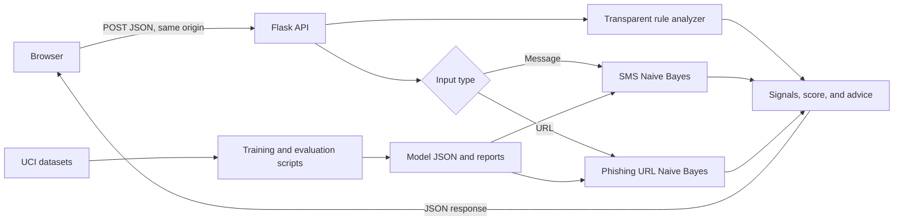

# ScamLens AI

**An explainable first-pass scam screener for suspicious messages and URLs.**

ScamLens pairs transparent warning rules with lightweight Naive Bayes baselines. The web interface explains the signals it found and suggests safer next steps. It is an educational prototype, not a security product or a guarantee that content is safe.

## Product overview

| Capability | Implementation |
| --- | --- |
| Responsive website | Flask backend with custom HTML, CSS, and JavaScript frontend |
| Message screening | Rules for urgency, threats, credential requests, unusual payment, prize language, and visible links |
| SMS baseline | Pure-Python multinomial Naive Bayes with word unigrams and adjacent bigrams |
| URL screening | URL-text heuristics plus a categorical Naive Bayes phishing baseline; links are never opened |
| Explanations | Rule signals, model clues, separate scores, and cautious next-step guidance |
| Evaluation | SMS holdout benchmark and host-disjoint URL train/validation/test evaluation |
| Inference | Local model files; no external AI API; submitted scans are not saved as history |

## How it works



The rule-based risk score and model scores are separate. Model scores are raw, uncalibrated class scores—not probabilities that content is fraudulent. The URL model examines the visible URL text and does not fetch the page.

## Run the website locally

Python 3.12.10 is the project runtime. From PowerShell in the project folder:

```powershell
py -3.12 -m venv .venv
.\.venv\Scripts\python.exe -m pip install -r requirements.txt
.\.venv\Scripts\python.exe web_app.py
```

Open `http://127.0.0.1:5000`. Press **Ctrl+C** in PowerShell to stop the server. The included model files let a fresh checkout run without downloading the training datasets.

The earlier Streamlit prototype remains available with:

```powershell
.\.venv\Scripts\python.exe -m streamlit run app.py
```

## Reproduce training and evaluation

Training downloads public UCI datasets and may take a few minutes. It is not needed just to run the website.

```powershell
.\.venv\Scripts\python.exe train_model.py
.\.venv\Scripts\python.exe train_url_model.py
```

The URL script creates deterministic, host-disjoint train/validation/test splits, selects the threshold on validation F1, evaluates on the separate test set, and writes a defanged false-positive/false-negative report. Dataset ZIP files stay under `data/raw/` and are excluded from Git.

## Evaluation

These are dataset results, not expected performance on every current scam. Precision and recall use spam or phishing as the positive class.

| Model | Dataset and evaluation | Accuracy | Precision | Recall | F1 |
| --- | --- | ---: | ---: | ---: | ---: |
| SMS spam | UCI SMS Spam Collection; 1,031-message stratified holdout | 98.8% | 96.8% | 93.8% | 95.2% |
| Phishing URL | UCI PhiUSIIL; 35,305-URL host-disjoint test split | 93.1% | 97.2% | 86.4% | 91.5% |

The URL threshold **0.607903** was selected to maximize F1 on a separate validation split. Its train/validation/test sets contain 164,759 / 35,306 / 35,305 URLs, with zero normalized-host overlap. The test confusion matrix is `[[19852, 375], [2053, 13025]]` (rows: actual legitimate/phishing; columns: predicted legitimate/phishing).

The SMS model detects patterns in English SMS spam data; this is only a limited proxy for scams. URL host grouping normalizes `www.` but does not use a complete public-suffix list, so sibling subdomains may be separated. The URL data has no collection timestamps, so temporal evaluation is unavailable. See [URL error analysis](reports/phishing_url_error_analysis.md); example links are defanged and paths redacted.

## Deploy a live demo

The repository includes a [Render Blueprint](render.yaml). After pushing the project to GitHub, connect the repository to Render and create the service from `render.yaml`. Render uses `requirements.txt`, starts `serve.py` with Waitress, and checks `/healthz`. See [Render's Flask deployment guide](https://render.com/docs/deploy-flask) and [Python version settings](https://render.com/docs/python-version).

The public service has not been created yet. A hosted demo receives submitted text on its server even though the app does not save it as scan history. Do not enter passwords, one-time codes, financial data, or private messages.

## Sources and attribution

- Almeida, T. & Hidalgo, J. (2011). [SMS Spam Collection](https://archive.ics.uci.edu/dataset/228/sms%2Bspam%2Bcollection). UCI Machine Learning Repository. CC BY 4.0.
- Prasad, A. & Chandra, S. (2024). [PhiUSIIL Phishing URL (Website)](https://archive.ics.uci.edu/dataset/967/phiusiil%2Bphishing%2Burl%2Bwebsite%2Bdataset). UCI Machine Learning Repository. CC BY 4.0.

Dataset archives are excluded from Git. The small model artifacts and evaluation reports are included with source attribution so a fresh checkout can run the demo.

## Repository map

```text
web_app.py                     Flask API and local website entry point
serve.py                       Waitress production server entry point
templates/index.html           Website structure
static/styles.css              Responsive visual design
static/app.js                  Browser interactions and result rendering
src/analyzer.py                Rule-based analysis and explanations
src/ml_model.py                SMS model scoring and clues
src/url_model.py               URL features, model scoring, and clues
train_model.py                 SMS training and evaluation
train_url_model.py             Host-disjoint URL training and evaluation
render.yaml                    Render service configuration
models/*.json                  Small pre-trained model files
reports/                       Metrics and defanged URL error analysis
```

## Resume summary

Built ScamLens AI, a responsive Flask web app that combines transparent scam-warning rules with pure-Python Naive Bayes baselines; evaluated phishing URL detection with host-disjoint train/validation/test splits, reaching 93.1% accuracy and 97.2% precision on a held-out UCI URL test set.

## Software license

Dataset attribution is listed above. Choose and add a software license before redistributing this code; no software license has been selected for this project yet.
